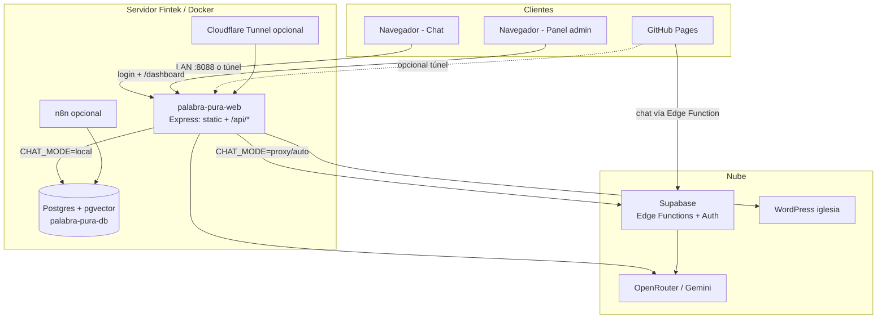
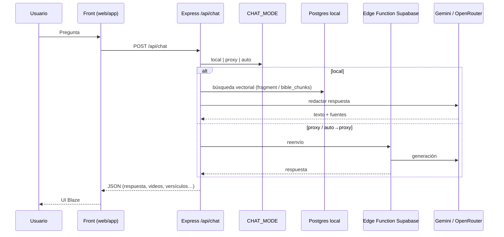

# Arquitectura actual — Palabra Pura (Blaze)

> Documento técnico. Fecha de corte: noviembre 2026.  
> Repo: [PalabraPuraIA/palabra-pura](https://github.com/PalabraPuraIA/palabra-pura)  
> Companion docs: [GUIA-USUARIO.md](./GUIA-USUARIO.md) · [HANDOFF-INGENIERO.md](./HANDOFF-INGENIERO.md)

## 1. Qué es el sistema

Chatbot de la **Escuela Bíblica / Enciclopedia de Palabra Pura** (“Blaze”).  
Responde preguntas con enseñanzas del ministerio (videos, fragmentos, Biblia) y ofrece un **panel admin** para analytics, conocimiento e ingesta.

## 2. Vista de alto nivel



## 3. Componentes del monorepo

| Path | Rol |
|------|-----|
| `web/app/` | Frontend: chat, login, dashboard |
| `web/server/` | API Express (`/api/chat`, auth, knowledge, ingest, analytics) |
| `docs/` | Copia estática para **GitHub Pages** (mismo front) |
| `stack/` | Docker Compose, scripts backup/restore/deploy |
| `db/` | Schemas SQL (dump grande en GitHub Releases) |
| `supabase/functions/` | Edge Functions (chatbot, knowledge-hub, create-fragment, enciclopedia) |
| `n8n-workflows/` | Exports de ejemplo (ingesta / embeddings) |

## 4. Despliegues

| Entorno | URL típica | Qué corre |
|---------|------------|-----------|
| **Producción LAN** | `http://10.45.178.129:8088/` | Docker en `server-fintek` |
| **Demo pública** | URL Cloudflare (`/api/public-url`) | Túnel → `web` |
| **GitHub Pages** | `https://palabrapuraia.github.io/palabra-pura/` | Solo front estático en `docs/` |

### Contenedores Docker (`stack/docker-compose.yml`)

| Contenedor | Puerto host | Función |
|------------|-------------|---------|
| `palabra-pura-web` | 8088 → 80 | UI + cerebro `/api/*` |
| `palabra-pura-db` | 5488 → 5432 | Postgres + pgvector |
| `palabra-pura-n8n` | 5688 → 5678 | Workflows (opcional) |
| `palabra-pura-tunnel` | — | HTTPS público (opcional) |

## 5. Flujo del chat



### Modos (`CHAT_MODE` en `stack/.env`)

| Valor | Comportamiento |
|-------|----------------|
| `local` | Postgres propio + embeddings Gemini + LLM |
| `proxy` | Reenvía a Edge Function Supabase |
| `auto` | Prefiere `local` si hay claves/BD; si no, `proxy` |

**Embeddings:** modelo `gemini-embedding-001`, **3072 dims**. Cambiar el modelo obliga a re-vectorizar.

## 6. Autenticación (estado actual)

```mermaid
flowchart LR
  Login[login.html] --> Admin[Usuario + contraseña panel]
  Admin -->|OK| Token[Token panel / JWT simple]
  Token --> Dash[/dashboard/*]
  ChatPublic[Chat /] --> Open[Público sin login]
```

- **Chat:** público (sin cuenta).
- **Panel admin:** solo usuario/contraseña (`ADMIN_USER` / `ADMIN_PASSWORD`).  
  Login Google y registro por correo **fueron removidos** del front.
- Rutas admin API llevan `requireAuth`; páginas `/dashboard` usan `requireAuthPage`.

## 7. API principal (`web/server`)

Detalle consumido vs directo: **[ENDPOINTS.md](./ENDPOINTS.md)**.  
Sync Pages: `./stack/scripts/sync-pages.sh`

| Método | Ruta | Auth | Uso |
|--------|------|------|-----|
| GET | `/api/health` | no | Healthcheck |
| POST | `/api/auth/login` | no | Login admin |
| GET | `/api/auth/me` | sí | Sesión |
| POST | `/api/chat` | no | Pregunta al chatbot |
| GET | `/api/chat/status` | no | Modo activo |
| GET | `/api/life-areas` | no | Áreas de vida |
| GET/PATCH/DELETE | `/api/knowledge*` | sí | Admin conocimiento |
| POST | `/api/knowledge-hub` | sí | Hub (espejo Edge) |
| GET/POST… | `/api/facts*` | sí | Hechos / corpus |
| GET/POST | `/api/ingest*` | sí | Ingesta de archivos |
| GET | `/api/articles` | no | Proxy WP |
| POST | `/api/analytics/event` | no | Eventos chat |
| POST | `/api/analytics/rate` | no | Rating útil / no útil |
| GET | `/api/analytics/summary` | sí | Dashboard |
| GET | `/api/public-url` | no | URL del túnel |

## 8. Datos (contenido)

Origen principal: proyecto Supabase del compañero + réplica/uso local en Postgres.

Tablas relevantes (órdenes de magnitud históricos):

| Tabla | Contenido |
|-------|-----------|
| `video` | Metadatos de enseñanzas |
| `fragment` | Chunks con embeddings |
| `bible_chunks` / `bible_parents` | Biblia vectorizada |
| `verses` / `books` | Texto bíblico |

Analytics del panel: archivo JSON en volumen `pp_web_data` (`analytics.json` / conversation store), no necesariamente en Postgres.

## 9. Frontends

| Superficie | Path | Notas |
|------------|------|-------|
| Chat | `web/app/index.html` + `js/` | Blaze / Grace UI |
| Login admin | `web/app/login.html` | Solo panel admin |
| Dashboard | `web/app/dashboard/` | Analytics, knowledge, ingest |
| Pages mirror | `docs/*` | Publicado en GitHub Pages |

Config runtime: `web/app/js/config.js`  
- En server Fintek: `endpoint = /api/chat`  
- En GitHub Pages: Edge Function Supabase (+ `fintekBaseUrl` de túnel si aplica)

## 10. Integraciones externas

| Servicio | Para qué |
|----------|----------|
| Supabase | Edge Functions, Auth residual, contenido |
| Gemini | Embeddings (+ generación según flujo) |
| OpenRouter | LLM de respuesta (`OPENROUTER_MODEL`) |
| WordPress | Artículos (`iglesiapalabrapura.com`) |
| Cloudflare | Túnel HTTPS de demo |
| YouTube | Videos citados en respuestas (metadatos en BD) |

## 11. Secretos (nunca en git)

Ver `stack/.env.example`. Mínimos críticos:

- `POSTGRES_PASSWORD`
- `GEMINI_API_KEY` / `OPENROUTER_API_KEY` (modo local)
- `SUPABASE_PUBLISHABLE_KEY` / URLs de funciones
- `ADMIN_PASSWORD`, `AUTH_SECRET`

## 12. Diagrama de carpetas (mental)

```
palabra-pura/
├── web/app          → UI
├── web/server       → API
├── docs             → GitHub Pages
├── stack            → Docker + scripts
├── db               → SQL
├── supabase         → Edge Functions + migrations
└── n8n-workflows    → Ingesta (opcional)
```
