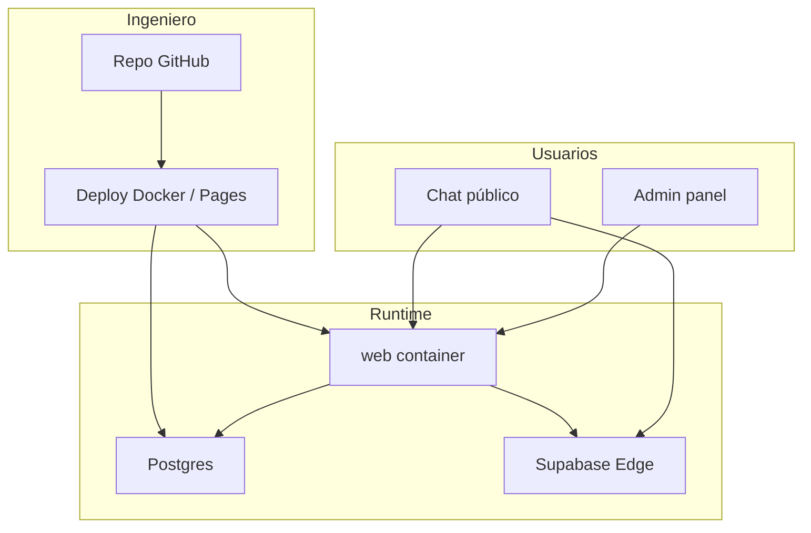

# Handoff para ingeniero — Palabra Pura

Checklist y mapa operativo para quien recibe el proyecto.  
Complementa [ARQUITECTURA.md](./ARQUITECTURA.md) y [GUIA-USUARIO.md](./GUIA-USUARIO.md).

## 0. En 15 minutos debes poder

1. Clonar el repo privado `PalabraPuraIA/palabra-pura`.
2. Levantar `stack/docker-compose.yml`.
3. Abrir chat en `:8088` y login admin.
4. Ver `GET /api/chat/status` y entender si estás en `local` o `proxy`.

## 1. Cuentas y ownership

| Recurso | Cuenta / dato |
|---------|----------------|
| GitHub | org `PalabraPuraIA` · repo `palabra-pura` |
| Email proyecto | `palabrapuraia@gmail.com` |
| Servidor | Ubuntu `server-fintek`, user `fintek-1`, IP LAN `10.45.178.129` |
| Ruta en server | `/home/fintek-1/palabra-pura` |
| Supabase (front actual en config) | proyecto `jkffgudzlcemapxprbws` |
| WordPress | `iglesiapalabrapura.com` |

Documentos ya existentes: `README.md`, `SERVIDOR.md`, `CONEXION.md`, `ACCESO-OTRO-PC.md`, `ULTIMA-VERSION.md`.

## 2. Ramas

| Rama | Uso |
|------|-----|
| `main` | Producción / fuente de verdad del código |
| `Develop` | Histórico distinto (no es fast-forward de `main`); no asumir merge limpio |

GitHub Pages publica desde la carpeta **`docs/`** (espejo del front).

## 3. Arranque local

```bash
cd stack
cp .env.example .env
# editar POSTGRES_PASSWORD, CHAT_MODE, claves LLM si quieres local
docker compose up -d --build
```

URLs:

- Chat: http://localhost:8088/
- Dashboard: http://localhost:8088/dashboard/ (tras login)
- n8n: http://localhost:5688/
- Postgres: `localhost:5488`

Restore BD (si tienes dump de Releases):

```bash
./scripts/restore-db.sh ~/Downloads/palabra-pura-db-YYYY-MM-DD.sql.gz
```

## 4. Mapa de código que tocarás más

| Área | Archivos |
|------|----------|
| Entrada API | `web/server/index.js` |
| Chat | `web/server/chat.js`, `chat-retrieve.js`, `chat-search.js`, `chat-llm.js`, `chat-guard.js` |
| Auth panel | `web/server/auth.js`, `web/app/login.html`, `web/app/js/login-page.js` |
| Config front | `web/app/js/config.js` (**y** `docs/js/config.js` si Pages) |
| UI chat | `web/app/js/ui/ChatView.js`, `main.js` |
| Dashboard | `web/app/dashboard/*` |
| Edge Function | `supabase/functions/chatbot-iglesia-palabra-pura/` |
| Compose | `stack/docker-compose.yml`, `stack/.env` |

**Regla Pages:** antes de publicar, correr `./stack/scripts/sync-pages.sh` (copia `web/app` → `docs` sin borrar los `.md`).

## 5. Login admin (estado nov 2026)

- Solo **usuario + contraseña** de panel.
- Configurar en `stack/.env`: `ADMIN_USER`, `ADMIN_PASSWORD`, `AUTH_SECRET` (**cambiar defaults**).
- El front **ya no** acepta contraseñas hardcodeadas ni tokens `pp-panel.*` como sesión válida.
- Google OAuth y signup por email **eliminados** del login.
- En Pages, el login resuelve el API vía `docs/public-url.json` (túnel), no con URL Cloudflare fija.

Ver también [ENDPOINTS.md](./ENDPOINTS.md).

## 6. Chat: decisión de diseño crítica

```text
Pregunta → POST /api/chat → CHAT_MODE
  ├─ local  → pgvector + Gemini embeddings + OpenRouter/Gemini
  └─ proxy  → Edge Function Supabase
```

En el server Fintek suele resolverse **`auto` → proxy** si no hay claves locales.  
Para independencia total: poner claves + `CHAT_MODE=local` y BD con embeddings coherentes.

**No cambiar** el modelo de embeddings sin plan de reindex (`gemini-embedding-001` / 3072).

## 7. Operación en el servidor

```bash
ssh fintek-1@10.45.178.129   # con la llave autorizada
cd /home/fintek-1/palabra-pura/stack
docker compose ps
docker compose logs -f web
curl -s localhost:8088/api/chat/status
curl -s localhost:8088/api/public-url   # URL túnel vigente
```

Backup BD: `stack/scripts/backup-db.sh`  
Restore: `stack/scripts/restore-db.sh`

SSH desde otro PC: ver `ACCESO-OTRO-PC.md` (llave `id_ed25519_palabra_pc2`).

## 8. Diagrama de responsabilidades



## 9. Checklist de entrega (firmar mentalmente)

- [ ] Acceso GitHub org + repo
- [ ] Acceso SSH al server (o handover de llaves)
- [ ] Acceso Supabase (dashboard + keys en gestor de secretos, no chat)
- [ ] Dump reciente de BD en Releases o backup local
- [ ] `.env` de producción documentado (1Password / Doppler / equivalente)
- [ ] Saber URL Pages + URL LAN + cómo obtener túnel
- [ ] Probar: chat responde, login admin funciona, dashboard carga
- [ ] Leer `ARQUITECTURA.md` + `SERVIDOR.md`

## 10. Deuda / riesgos conocidos

1. **`Develop` ≠ `main`** (historias no relacionadas): no merges a ciegas.
2. **Túnel Cloudflare** cambia URL al reiniciar → mantener `docs/public-url.json` / watchdog.
3. **Doble front** mitigado con `./stack/scripts/sync-pages.sh` (correr antes de publicar Pages).
4. **Modo proxy** depende de Supabase/cuotas; planear `CHAT_MODE=local` estable.
5. Analytics: Postgres `chat_interactions` / `chat_ratings` + fallback JSON en `pp_web_data`.
6. Rotar `ADMIN_PASSWORD` / `AUTH_SECRET` en el server si aún usan defaults históricos.

## 11. Primeros tickets sugeridos para el nuevo ingeniero

1. Inventario de secretos + rotación `ADMIN_PASSWORD`.
2. Script o CI que sincronice `web/app` → `docs` al merge a `main`.
3. Health dashboard (status chat + última ingestión + tamaño corpus).
4. Alinear documentación de IDs Supabase (hay referencias históricas a otros project refs).
5. Plan de modo `local` estable en el server (claves + restore verificado).

## 12. Contactos

Completar al entregar:

| Rol | Nombre | Canal |
|-----|--------|-------|
| Producto / ministerio | | |
| Dueño técnico anterior | | |
| Acceso server Fintek | | |
| Acceso Supabase | | |
